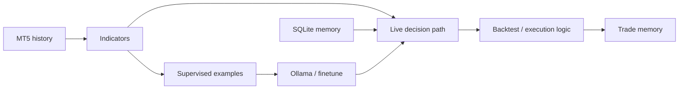

# 🧠 MIDAS Lite — verified legacy AI-trading dossier

> **Статус:** 🕰️ LEGACY / 🔬 R&D.
> **Проверено по фактическому Python source:** 29.09.2026.
> **Состав:** два крупных MT5/Ollama trading prototypes + system artifacts.
> **Никакая доходность не считается доказанной из названий/промптов внутри кода.**

## 1. 🎯 Задача

`midas_lite` содержит legacy AI-trading experiments, объединяющие:

- MetaTrader5;
- technical indicators;
- local Ollama LLM;
- dataset/fine-tune workflows;
- backtest/live modes;
- SQLite memory;
- position rotation;
- heuristic/agentic reasoning.

Это исследовательский предшественник более формального MIDAS stack.

## 2. 📦 Фактический repository

```text
midas_lite/
├── Shtenco_AI_V16_PROFIT_ROTATION333.py
├── agi_trader_final_v1.py
├── systems/
│   └── eurusd_h1_v5_fixed_q90_sl45/
├── README.md
└── LICENSE
```

Основные Python files крупные (~39 KB и ~69 KB).

## 3. 🤖 V16 Profit Rotation prototype

`Shtenco_AI_V16_PROFIT_ROTATION333.py` declares:

- 8 FX symbols;
- M5/M15/H1/H4/D1;
- local Ollama model;
- SQLite trade/memory/pattern database;
- technical indicators;
- concurrent market download;
- dynamic Kelly-like leverage helper;
- open position/equity simulation state;
- agentic prompt machinery.

Config includes:

```text
RISK_PERCENT = 10.0
MAX_POSITION_SIZE = 5.00
```

These are aggressive research defaults and must not be interpreted as production risk policy.

## 4. 🧠 Memory database

SQLite schema stores:

### trades
- symbol/direction/lot;
- entry/exit;
- PnL/result;
- confidence/reason;
- market hash;
- scenarios.

### memory
- market hash;
- symbol;
- decision/outcome;
- reasoning;
- market conditions;
- lessons;
- importance.

### patterns
- name/description;
- success rate;
- occurrences;
- average profit;
- conditions.

This is an actual persistence design, not merely prompt text.

## 5. 🧮 Market hash

Current market hash compresses H1 state into:

```text
trend: close > MA20
RSI zone: oversold/overbought/mid
MACD relation: BUY/SELL
```

then hashes the short state string with truncated MD5.

This is a **coarse categorical key**, not a cryptographically meaningful representation of market state.

Collision/aliasing is expected at semantic level because many distinct markets map to the same 3-category tuple.

## 6. 📊 Technical features

Source implements/manual-calculates:

- RSI;
- moving averages;
- Bollinger bands;
- EMA;
- MACD;
- multi-timeframe data.

It also computes equity and floating PnL from simplified pip/lot arithmetic.

Those calculations require broker-contract parity before real PnL equivalence can be claimed.

## 7. ⚖️ Kelly-like sizing helper

`calculate_kelly_leverage()` estimates from observed trade history:

- win rate;
- average win/loss;
- Kelly-style fraction;

then clamps result between 1% and 10%.

Important boundary:

```text
in-sample historical Kelly estimate != safe live leverage
```

Small sample instability and regime changes need dedicated controls.

## 8. 🤖 AGI Trader V1

`agi_trader_final_v1.py` declares five modes in its header:

1. Push;
2. Finetune;
3. Backtest;
4. Live;
5. Dataset.

Defaults include:

- six FX pairs;
- M15;
- LOOKBACK 400;
- initial balance 10,000;
- risk per trade 0.5%;
- minimum probability threshold 70;
- live lot 2.00;
- prediction horizon 96 M15 bars = 24h.

## 9. 📐 Feature pipeline in AGI Trader

`calculate_features()` computes:

- ATR;
- RSI;
- MACD + signal;
- volume ratio;
- Bollinger bands/position;
- stochastic K/D;
- EMA50/EMA200.

Rows with NaN from rolling warm-up are dropped.

## 10. 🧪 Supervised dataset generation

Real MT5 dataset generator:

- takes past 6 months;
- enumerates candidate points;
- defines label from future bar at +96 bars;
- samples UP/DOWN to target class balance;
- constructs prompt at current timestamp;
- constructs response containing the **actual future 24h result**.

This is acceptable as a supervised-label construction technique **only if these examples stay entirely inside training data and future labels never leak into validation/test inputs or prompt generation at inference**.

The generated response literally includes the future realized direction/price, so train/test isolation is critical.

## 11. 🚨 Synthetic fallback caveat

If MT5 unavailable, source can generate synthetic labeled examples.

Those examples derive direction/price move from heuristic indicator scores plus randomness.

A model trained/evaluated on such synthetic patterns can learn generator rules rather than real market structure.

Therefore:

```text
synthetic dataset performance != market performance
```

## 12. ⚠️ Potential dataset/evaluation hazards

- class balancing changes natural base rates;
- oversampling duplicates minority examples;
- response text contains future outcomes by design;
- any split after duplicated oversampling can leak near-identical examples if not group-aware;
- dynamically using latest 6 months hurts exact reproducibility;
- broker history can differ;
- no dataset manifest/hash visible at root.

## 13. 🏗️ Architecture



## 14. 🛡️ Authority / safety boundaries

```text
LLM confidence != calibrated probability
chain-of-thought prompt != trading proof
historical memory != stable alpha
backtest != realized P&L
synthetic labels != market evidence
live mode != safe production execution
Kelly estimate != risk authorization
```

Modern SYNERGY should put deterministic RiskGuard/TradeMux gates after any legacy AI suggestion.

## 15. 🧪 Required validation before reuse

1. freeze exact data;
2. causal timestamp split;
3. no oversampling before split;
4. group duplicates;
5. walk-forward;
6. compare no-LLM baseline;
7. compare technical heuristic baseline;
8. costs/spread/slippage;
9. broker contract specs;
10. seed all stochastic paths;
11. remove future data from any inference-time prompt;
12. independent QuantLab gate.

## 16. 💸 Live-execution risks

Any live mode requires:

- hard daily/weekly loss guard;
- max total exposure;
- symbol correlation;
- lot normalization;
- spread guard;
- market-hours handling;
- order idempotency;
- broker error reconcile;
- kill switch.

Legacy code should not be deployed before these are independently verified.

## 17. 🛠️ Reproducibility

Current source depends on:

- MetaTrader 5 terminal/history;
- optional Ollama/model availability;
- local filesystem/SQLite;
- dynamic current dates.

For scientific replay, create a frozen dataset and environment manifest instead of relying on “last 6 months”.

## 18. 🗺️ Repository map

| Path | Role |
|---|---|
| `Shtenco_AI_V16_PROFIT_ROTATION333.py` | multi-timeframe memory/rotation prototype |
| `agi_trader_final_v1.py` | MT5 dataset/finetune/backtest/live prototype |
| `systems/` | saved/derived system artifacts |
| README | verified dossier |

## 19. 🔗 Место в SYNERGY

Legacy research should feed:

```text
candidate idea
→ modern typed feature/signal producer
→ QuantLab
→ RiskGuard
→ TradeMux
```

It should not bypass modern deterministic gates.

## 20. 📊 Evidence maturity

| Layer | Status |
|---|---|
| substantial legacy code | ✅ |
| MT5 integration | ✅ source |
| Ollama integration | ✅ source |
| SQLite memory | ✅ |
| synthetic fallback | ✅ but not evidence |
| strict frozen OOS | not established here |
| transaction-cost parity | incomplete |
| calibrated LLM probability | ❌ |
| production safety | ❌ |

## 21. 🚀 Roadmap

- freeze representative dataset;
- audit train/test leakage;
- reproduce legacy backtests;
- extract useful deterministic modules;
- baseline against no-LLM;
- causal walk-forward;
- feed candidates into QuantLab;
- add RiskGuard/TradeMux integration;
- archive legacy source unchanged after distillation.

## 22. 🛑 Что project НЕ утверждает

- that “AGI” labels mean general intelligence;
- that local LLM reasoning creates alpha;
- that synthetic dataset results transfer to real FX;
- that backtest/live modes are safe;
- that code titles like “PROFIT ROTATION” prove profit;
- that remembered patterns predict future regimes.

---

[🧭 SYNERGY SYSTEM](https://github.com/Shtenco/synergy_system) · [📚 Atlas](https://github.com/Shtenco/synergy_system/blob/main/docs/SYNERGY_REPOSITORY_ATLAS.md)
