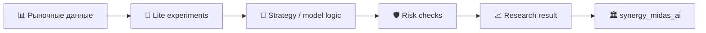

# 📈 MIDAS Lite

> **Облегчённая исследовательская ветка MIDAS для локальных торговых экспериментов и быстрых прототипов.**  
> Архитектурный родитель: [`synergy_midas_ai`](https://github.com/Shtenco/synergy_midas_ai)  
> Системный корень: [`synergy_system`](https://github.com/Shtenco/synergy_system)

---

## 🎯 Зачем существует MIDAS Lite

`midas_lite` нужен как компактный R&D-контур между однофайловыми торговыми экспериментами и большим институциональным стеком MIDAS. В репозитории уже присутствуют два крупных Python-скрипта и каталог `systems/`, поэтому это не пустой концепт, но и не канонический production-runtime всей торговой системы.



## 📦 Текущие артефакты main

| Путь | Назначение |
|---|---|
| `Shtenco_AI_V16_PROFIT_ROTATION333.py` | крупный Python-прототип торговой/rotation логики |
| `agi_trader_final_v1.py` | отдельная ветка AGI-trader прототипа |
| `systems/` | набор систем/экспериментальных модулей |
| `LICENSE` | лицензия репозитория |

Наличие этих файлов подтверждает существование исследовательского кода, но само по себе не подтверждает доходность, отсутствие look-ahead, корректность live execution или устойчивость OOS.

## 🧪 Что должно быть доказано

Перед повышением статуса до подтверждённого исследовательского компонента нужны:

- фиксированный dataset provenance;
- разделение train / validation / test / OOS;
- отсутствие leakage и look-ahead;
- точная модель комиссий, spread и slippage;
- детерминированные seeds/configs;
- сохранённые отчёты и метрики;
- сравнение с простыми baseline;
- risk limits и veto;
- воспроизводимый запуск.

## 🛡️ Граница утверждений

```text
backtest equity      != деньги
paper result         != live P&L
high win-rate        != low risk
AI score             != authorization
strategy idea        != verified edge
```

## 🔗 Связи

- [`synergy_midas_ai`](https://github.com/Shtenco/synergy_midas_ai) — интегрированный MIDAS;
- [`synergy_midas_institutional`](https://github.com/Shtenco/synergy_midas_institutional) — институциональная архитектура;
- [`synergy_riskguard`](https://github.com/Shtenco/synergy_riskguard) — независимые риск-политики;
- [`synergy_quantlab`](https://github.com/Shtenco/synergy_quantlab) — leakage-safe validation;
- [`synergy_agi_trader`](https://github.com/Shtenco/synergy_agi_trader) — AGI/trading линия.

## 🚀 Roadmap

- [ ] инвентаризировать `systems/`;
- [ ] вынести конфиги и datasets из кода;
- [ ] добавить unit/smoke tests;
- [ ] подключить QuantLab validation;
- [ ] отделить сигнал от исполнения;
- [ ] добавить RiskGuard contract;
- [ ] сохранить OOS/evidence artifacts;
- [ ] описать migration path в основной MIDAS.

## 🧭 Навигация по экосистеме

- [Атлас всех 75 репозиториев](https://github.com/Shtenco/synergy_system/blob/main/docs/SYNERGY_REPOSITORY_ATLAS.md)
- [Машиночитаемый реестр](https://github.com/Shtenco/synergy_system/blob/main/registry/SYNERGY_REPOSITORIES.json)
