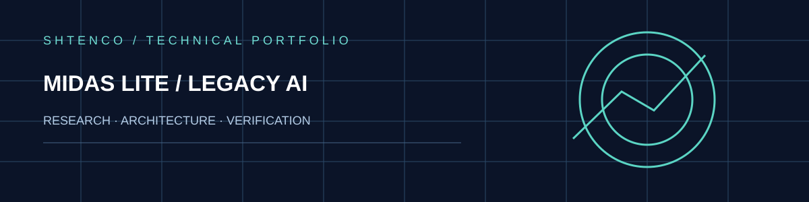

# MIDAS Lite — AI trading research and EURUSD H1 specialist

The repository unites two independent lines of applied research: a locally reasoned MT5/Ollama market agent with structured SQLite memory, and a precisely specified EURUSD H1 statistical specialist with saved validation and sealed evaluation reports. Both merit careful technical presentation without confusing a model result with broker-confirmed returns.

## Research proposition

A robust market hypothesis should specify what is predicted, the exact moment the information becomes available, how the selection rule was chosen, and how a genuinely unseen slice was evaluated. MIDAS Lite combines flexible agent experiments with an increasingly strict specialist model focused on one event: the broker-time transition **23:00 to 00:00, exactly one hour apart**.

## Implemented components

| Source | Contribution |
|---|---|
| Shtenco_AI_V16_PROFIT_ROTATION333.py | Multi-symbol market state, agent prompting, trade/memory/pattern database in SQLite, Ollama experimentation |
| agi_trader_final_v1.py | Independent earlier AI trading prototype |
| systems/eurusd_h1_v5_fixed_q90_sl45/core/ | Historical quote validation, feature engineering, Ridge magnitude estimate, gradient-boosted direction classifier |
| systems/eurusd_h1_v5_fixed_q90_sl45/V5_CONFIG.json | Frozen model settings, 0.90 validation selection quantile and 4.5-pip hard stop |
| systems/eurusd_h1_v5_fixed_q90_sl45/reports/ | Auditable JSON summaries of different research splits |

The specialist builds lagged and windowed returns, volatility, candlestick geometry, cyclical clock signals and spread features. It explicitly distinguishes train, validation and held-out data and excludes nonconsecutive bar transitions.

## Quantitative definitions

For EURUSD closing prices P(t) and pip size p = 0.0001, a signed next-bar move is:

$$
m_{t+1}=\frac{P_{t+1}-P_t}{p}.
$$

If a score threshold is selected from validation at quantile q = 0.90, the experimental decision gate is:

$$
\mathrm{select}_t=\mathbf{1}\{s_t\geq\tau_{0.90}^{\mathrm{validation}}\}.
$$

The chosen threshold must remain unchanged on a sealed period. If each trade has gross pips g(i) and full cost c(i), the estimated net sum is:

$$
N=\sum_{i=1}^{n}(g_i-c_i).
$$

## Preserved evidence and interpretation

The fixed V5 configuration records **100 two-month rolling windows, 415 OOS selected signals, 68.67% directional accuracy and 688.0 modeled gross pips**. These are recorded research figures, not live audited profits. The separate June–July 2026 sealed report records **36 eligible bars, four selected trades, three correct directions and −1.5 gross pips**. At an assumed all-in 0.5 pip per selected trade, the report records **−3.5 net pips**.

The existence of both a stronger rolling summary and a less favourable independent slice is informative: directional correctness, sample coverage, trade expectancy and operational costs answer different scientific questions. Inference about robustness requires several fresh nonoverlapping test periods.

## Why it matters

The original work is a useful bridge between memory-driven trading agents and focused rule-governed ML. Its scientific value lies in strict event definition, fixed quantile selection, structured memory, saved artifacts and explicit cost sensitivity. A prospective next milestone is one immutable per-experiment manifest with quote hashes, broker time zone, source commit, parameter gate, per-trade ledger and confidence intervals.

## Reading and reproducibility

Start with the specialist subdirectory README, configuration and JSON reports before executing any legacy MT5 script. The standalone programs may include live trading pathways. Run only in an isolated research or demo environment. No actual MT5/Ollama or broker test was performed as part of this documentation revision.

[Specialist program](systems/eurusd_h1_v5_fixed_q90_sl45/) · [Frozen configuration](systems/eurusd_h1_v5_fixed_q90_sl45/V5_CONFIG.json) · [Sealed report](systems/eurusd_h1_v5_fixed_q90_sl45/reports/v4_sealed_2m_report.json)
